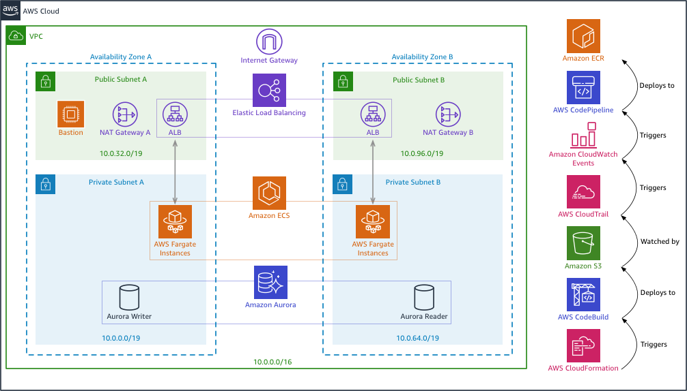
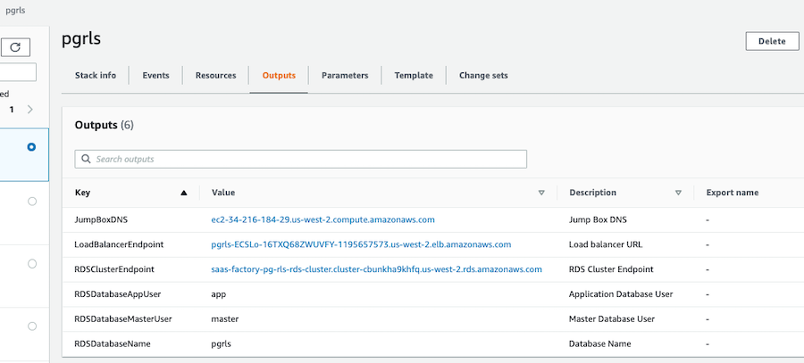

## Multi-tenant data isolation with PostgreSQL Row Level Security
Checkout the article on the AWS Database Blog [https://aws.amazon.com/blogs/database/multi-tenant-data-isolation-with-postgresql-row-level-security/](https://aws.amazon.com/blogs/database/multi-tenant-data-isolation-with-postgresql-row-level-security/)

Isolating tenant data is a fundamental responsibility for Software as a Service (SaaS) providers. In this sample, produced by the AWS SaaS Factory, we show you one way to implement multi-tenant data isolation using PostgreSQL row level security policies.

## Security notice — please read before deploying

**This sample demonstrates row level security. It is not production ready, and it should not be exposed to the internet.**

The specific thing to understand is that **the tenant login is not authentication.** It is a tenant
picker: the login page lists every tenant and submits the selected tenant's id as the "password".
`TenantAuthenticationProvider` ignores the username entirely and accepts any id belonging to a real
tenant. That is deliberate — it is what lets you switch tenants and watch the row level security
policies take effect, which is the point of the sample — but it means **anyone who can reach the
application can act as any tenant.** No row level security policy helps here: the policy is doing
exactly what it is told, and it is the tenant context that is unauthenticated.

Consequently:

- **The tenant picker is off unless a deployment opts in.** The application defaults
  `tenant.picker.enabled` to `false`, and with it off there is no provider that will accept a
  tenant id as a credential, so tenant login fails rather than authenticating whoever asks. The
  CloudFormation template in this repository sets `TENANT_PICKER_ENABLED=true`, because that
  deployment is the demonstration and is not reachable from the internet. **If you lift this code
  into your own application, leave it off and supply real authentication** — the default is the
  safe one deliberately, so the picker is not inherited by accident.
- **The load balancer is `internal` and its security group is scoped to the VPC.** Reach the
  application through the jump box, as described in *See it in action* below. Changing the scheme
  back to `internet-facing` puts a tenant picker on the public internet.
- **The tenant administration pages under `/admin` require credentials**, supplied as the
  `AdminUiUsername` and `AdminUiPassword` stack parameters. Those pages create, edit and delete any
  tenant over a database connection that is deliberately *not* bound by row level security, so they
  are the most privileged surface here. If no credentials are configured the `/admin` pages are
  unreachable rather than open.
- **Database passwords are held in SSM Parameter Store** as `SecureString` values and injected into
  the container as secrets.

**If you are adapting this sample**, replace the tenant login with real authentication — Amazon
Cognito, or any OIDC provider — and derive `app.current_tenant` from a verified token claim rather
than a form field. Adding a password to the tenant picker is not enough on its own: the tenant
identity has to come from something the user cannot choose.

## Prerequisites
You will need an AWS account that you have administrative access to in order to run the CloudFormation template. The demo creates a new VPC for its resources.

This sample creates resources in your account that are not included in the AWS free tier. Please clean up
these resources after experimenting to minimize costs.

## Getting Started
1. Simply launch the CloudFormation template [saas-factory-pg-rls.template](cfn/saas-factory-pg-rls.template) from the **cfn** folder. The stack will take a few minutes to complete.
2. If you'd like to SSH into a command line that has network access to the database and the `psql` client installed, enter a value for the EC2 keypair you'd like to use. If you don't enter a keypair, the jump box instance will not be created.
3. Enter values for the database super user name and password as well as an application user name and password.

So what did CloudFormation do? The stack created a new VPC network to isolate this sample from other resources in your account. The database passwords you chose were stored as secure parameters in Systems Manager. It then created an RDS PostgreSQL instance. Using CodeBuild, the GitHub repo was cloned and our Spring Boot sample app was built into a Docker image and pushed to the ECR repository. CodeTrail then triggered CodePipeline to deploy the image to ECS which launched it with Fargate. When the Spring sample app initializes it will bootstrap the database with the tables, RLS policies, and a login user for the app to use.

<p align="center"></p>

A number of resources were created in your account including:
- A new VPC with an Internet Gateway
- 2 public subnets and 2 private subnets spread across 2 availability zones
- A NAT gateway and routes in each of the public subnets
- A linux EC2 instance bastion or jump box in the first public subnet with PostgreSQL command line tools installed
- A security group allowing SSH access to the jump box
- An RDS PosgreSQL instance in a private subnet
- A security group allowing access to the RDS cluster by the jump box and by the ECS Fargate instances
- An ECR repository and an ECS cluster, task definition, and service
- A CloudWatch log group for ECS and 2 IAM roles for the task execution and the task itself
- An application load balancer with target group and listener to front the ECS service along with a security group
- A CodeBuild project and supporting S3 bucket that builds our Docker image and deploys it to the ECR repository
- A CodePipline to deploy the image from the repository to the ECS service
- A CodeTrail and supporting S3 bucket and CloudWatch event rule to trigger the pipeline when the build project completes
- IAM roles and bucket policies for the build, pipeline and trail

## See it in action
When the CloudFormation stack is completely finished, the sample environment is ready for you to experiment with. First, you need the endpoint URL for the load balancer. You can get this from the Outputs of the CloudFormation stack, or you can go to the EC2 console and find it listed under Load Balancers.

The load balancer is **internal**, so that hostname only resolves inside the VPC and you cannot
browse to it directly. Reach it by forwarding a local port through the jump box, which means you
need to have supplied an EC2 keypair when you created the stack:

```bash
ssh -i /path/to/your-key.pem -L 8080:<LoadBalancerEndpoint>:80 ec2-user@<JumpBoxPublicIp>
```

Then open `http://localhost:8080` in your browser. `LoadBalancerEndpoint` is the stack output shown
below; the jump box's public IP is in the EC2 console.

To use the Admin Tenant Management section you will be asked for the `AdminUiUsername` and
`AdminUiPassword` you set when you created the stack.

<p align="center"></p>

1. Once you've loaded the demo application you can go to the Admin Tenant Management section and add some tenants.
2. Next, go to the Tenant User Management section and login as one of your tenants.
3. Select the same tenant under the Manage Users for list and click the Go button.
4. Add users for this tenant.
5. Logout and repeat steps 2-4 for a different tenant.
6. Now try to manage users for a tenant different than the one you've logged in as and you'll see RLS protecting your solution from cross tenant access.

To see details of from the debugging logs, go to CloudWatch in your AWS Console and load the Log Group for **/ecs/saas-factory-pg-rls-app**.

## Time to clean up
CloudFormation cannot delete the stack until we do a little prep work. I find it easiest to do this in the AWS Console.
1. Go to CloudFormation -> select the stack you created and delete it. It will take a few minutes to delete the stack.
